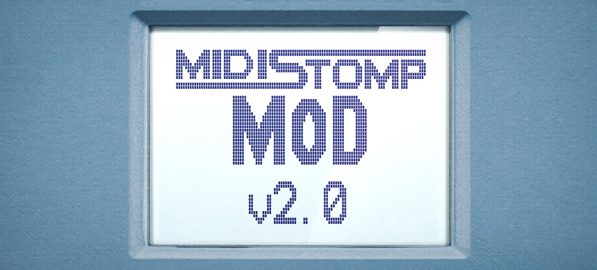
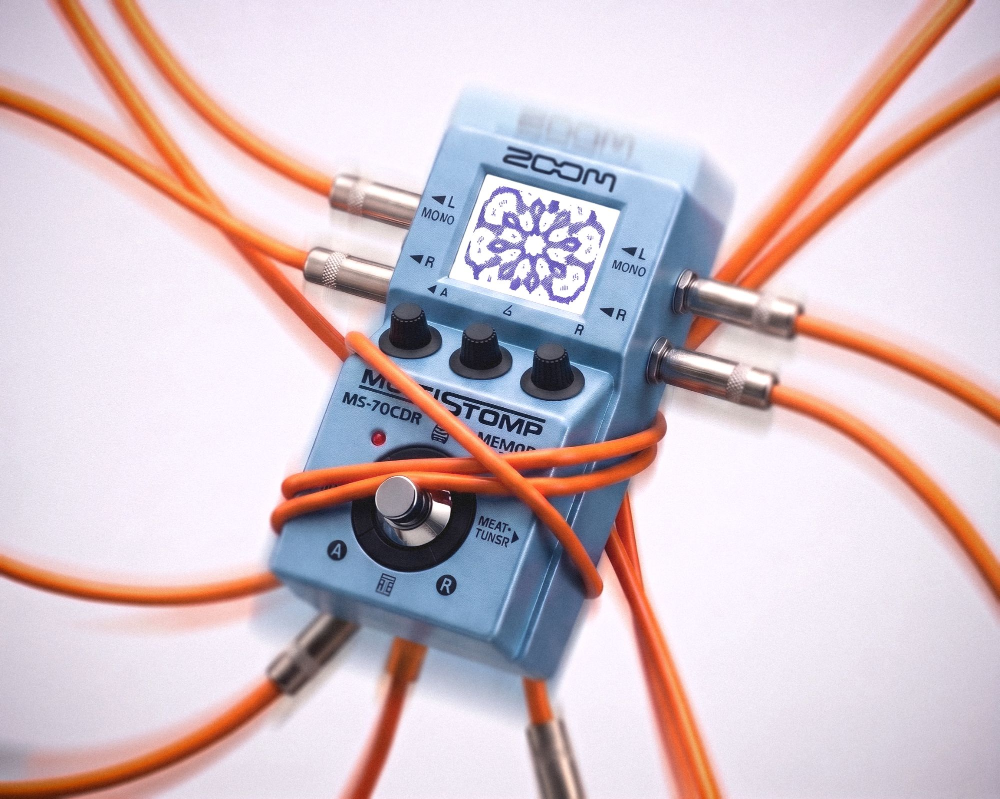
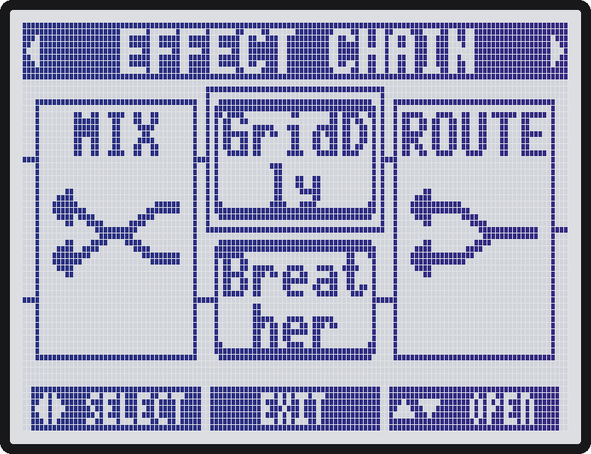
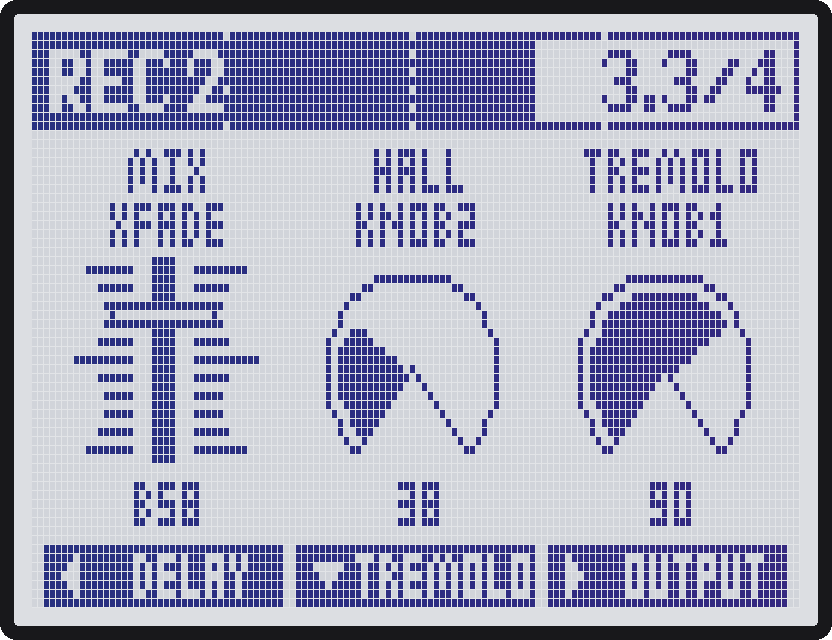
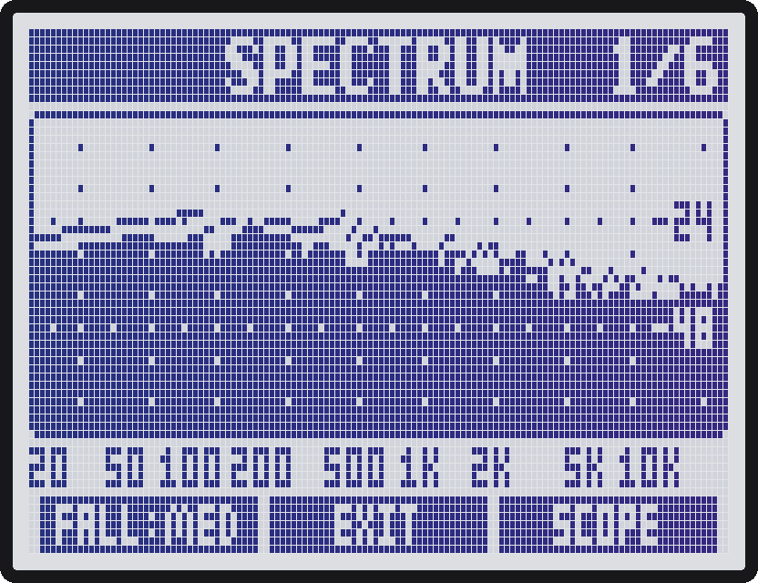
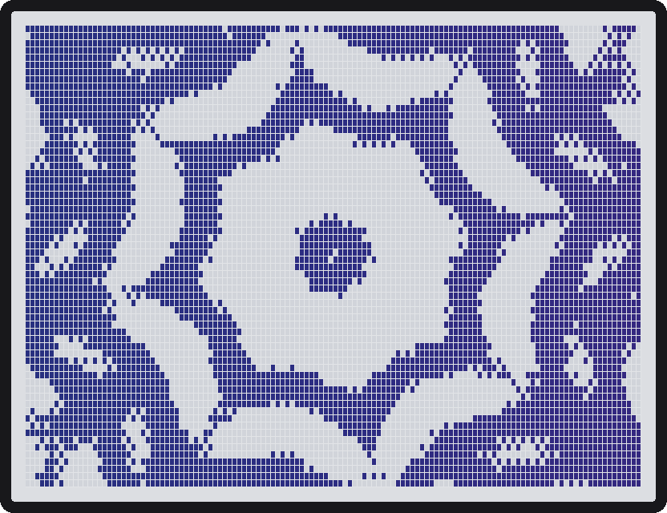

<h1 align="center">MIDISTOMP 2.0</h1>

<b>Custom firmware that turns a Zoom MultiStomp pedal into a performance instrument: 
effect chain routing, a looper, Perform mode, mastering meters, and full MIDI control.</b>

<a href="docs/user-guide.md"><b>User guide</b></a> ·
<a href="https://github.com/matujuice/zoom-ms-midistomp/releases">Download</a> ·
<a href="docs/user-guide.md#8-midi-and-the-cc-chart">MIDI chart</a> ·
<a href="#demo">Demo</a> ·
<a href="#custom-effects">Effects</a> ·
<a href="#feedback-and-support">Feedback</a>

MIDISTOMP is free and made by one person with one pedal. If it makes your pedal more fun, a coffee keeps it going: 
<a href="https://paypal.me/matujuice">PayPal</a> · <a href="https://buymeacoffee.com/matujuice">Buy Me a Coffee</a> · <a href="https://github.com/sponsors/matujuice">GitHub Sponsors</a>

## New here?

MIDISTOMP replaces the operating system of a Zoom **MS-50G, MS-60B or MS-70CDR** (the original models, not the
Plus or the Four series). The pedal keeps working the way you know: same effects, same patches, same knobs. On top
of that it gets new screens, new routing and full MIDI control from a DAW, an app or a drum machine. Same little
pedal, a lot more tricks.

To install it you need the pedal, a USB cable, a computer (Windows or Mac) and Zoom's free official updater. To play
it over MIDI you also need something that talks USB MIDI: a computer, an iPhone or iPad, or a USB-MIDI host box for
gear with DIN jacks. Your patches and installed effects are kept, and you can always go back to stock with Zoom's own
updater.

## What 2.0 adds

   

| | |
|---|---|
| **EFFECT CHAIN ROUTING** | Your chain can branch now. `[ROUTE]` splits it into two parallel buses and `[MIX]` brings them back together, with crossfade, levels, mute and solo per bus. The nodes don't take effect slots, so you still get 6 effects. On the MS-70CDR (SETTINGS > INPUT: STEREO) Split sends L to bus A and R to bus B, and the output can send bus A left and bus B right. A safety limiter at the very end catches level boosts, so the output never clips. |
| **PERFORM MODE** | Turn the pedal into an instrument: every knob, press and the footswitch gets a target (an effect knob, a routing control or the looper). Moves can wait for the next beat, bar or cycle, glide over time, and fire a follow move later. |
| **LOOPER** | GRDLOOP: a tempo-synced looper that records whole bars, with latched rolls (1/2 to 1/32), and keeps playing after MIDI Stop if you want. It works seamlessly with Perform mode, so a knob or the footswitch can record, roll and drop on the grid. |
| **MASTER** | Studio meters in a stompbox: SPECTRUM, SCOPE with a tuner, STEREO, LOUDNESS (LUFS), IN METER and OUT METER. Free while it's closed. |
| **KALEIDO** | A full-screen visual that dances to your sound and flashes on every beat of the MIDI clock. Pure fun. |
| **DSP 300** | The pedal's DSP limit goes from 225 to 300, so heavier patches fit. A counter in the MENU title bar shows the patch's DSP (`DSP 135/300`) and the CPU load. |
| **SYSTEM** | The old VERSION screen grows up: the version, the CPU load, the load of each effect, and how much each part of MIDISTOMP costs. Handy for finding what makes a heavy patch heavy. |

Everything is saved in the patch: routing, levels, the looper settings and the Perform setup.

## MIDI

 

| | |
|---|---|
| **Program Change** | loads patches from a DAW, an app or a drum machine |
| **Control Change** | effects 1-6 on/off and every knob, see the [CC chart](docs/user-guide.md#8-midi-and-the-cc-chart) |
| **MIDI clock + Start/Stop** | tempo-synced effects follow your clock; custom effects stay on the beat |
| **Patch up/down by CC** | CC 80 / 81 load the previous / next patch |
| **MIDI menu** | receive on/off per message type, MIDI channel, PC numbering |

## QOL improvements

Small things that make the stock pedal nicer to live with.

| | |
|---|---|
| **Tempo Lock** | set the tempo by turning the knob or tapping, and keep one tempo across patches |
| **HOLD FOR** | a footswitch hold opens the tuner or the tempo, or works as a momentary switch |
| **Faster scrolling** | left/right move faster and wrap around |
| **Button combos** | down + right = tuner, down + left = tempo |
| **EXIT goes back** | EXIT returns to the MENU entry you left |
| **INPUT MONO/STEREO** | tell the pedal which input it has, in SETTINGS |
| **Levels up to 150** | Input and Master levels go past unity (100) |

## Custom effects

**MIDISTOMP is at its best with the free custom effects from
[zoom-ms-zdl-effects-pack](https://github.com/matujuice/zoom-ms-zdl-effects-pack).**

Stock Zoom effects work fine: MIDI clock sets their tempo and CC moves their knobs. But they were made long before
this firmware: they don't know about MIDI Start/Stop, some delays cut out when the tempo changes, and nothing lines
up to the bar.

The effects in the pack are built around MIDISTOMP. They follow the pedal's tempo with no Tempo knob, lock to the
clock's grid, restart on the downbeat when your DAW or drum machine sends Start, and keep running after Stop.
Synced gates, pitch shifters, delays, filters, the looper, a choir and more. New effects keep coming.

[Get the effects](https://github.com/matujuice/zoom-ms-zdl-effects-pack) · [What each knob does](https://github.com/matujuice/zoom-ms-zdl-effects-pack/blob/main/docs/EFFECTS.md)

## Demo

MIDISTOMP on an MS-60B, sequenced on a Digitakt through Loopy Pro. In line effects on a Meeblip Triode. Click to watch on YouTube.

## Compatibility

| Pedal | Status |
|---|---|
| **MS-70CDR** | tested, with stereo input |
| **MS-60B** | tested (v1.2), mono input |
| **MS-50G** | tested (v1.2, from a Mac), mono input |
| MS-50G+, MS-70CDR+, MS-200D+ and the Four series | not supported: different hardware |

One build runs on all three pedals. It is made from Zoom's MS-70CDR 2.10 firmware, so after the update every pedal
reports itself as an MS-70CDR over USB. If you run it on a pedal not listed as tested, please
[tell me how it went](https://github.com/matujuice/zoom-ms-midistomp/issues).

## Install

1. Download [Zoom's official **MS-70CDR 2.10** updater](https://zoomcorp.com/en/us/multi-effects/multistomp-pedals/ms-70cdr/ms-70cdr-support/).
   Use it for every pedal, also the MS-50G and MS-60B.
2. Drag it onto **MIDISTOMP-builder.exe** from the [releases](https://github.com/matujuice/zoom-ms-midistomp/releases).
   It writes the MIDISTOMP updater next to it.
3. Hold the up and down keys while you plug in USB, then run the MIDISTOMP updater.

Full steps and recovery are in the [user guide](docs/user-guide.md#2-install-and-recovery).

**On a Mac:** it works today (tested on an MS-50G from an Apple Silicon Mac), but for now it's a bit of a ride:
Python, a build script and re-signing the app in Terminal. A much easier Mac install is on the way. Until then,
follow [On a Mac](docs/user-guide.md#on-a-mac).

## FAQ and troubleshooting

- **Can it brick my pedal?** The updater never rewrites the bootloader, so update mode (up + down while plugging
  in USB) always works and you can flash again. Read [docs/safety.md](docs/safety.md) first.
- **How do I go back to stock?** Enter update mode and run Zoom's original updater for your pedal. See
  [Recovery](docs/user-guide.md#recovery-and-going-back-to-stock).
- **Does it work on a Mac?** Yes, see [On a Mac](docs/user-guide.md#on-a-mac). An easier Mac install is coming.
- **Do my effects and patches survive?** Yes, the effects area is never touched.
- **Which effects work?** All stock effects, and every effect in the pack. Effect Manager keeps working.
- **No MIDI jacks?** MIDI runs over USB: plug into a computer or an iPhone/iPad, or use a USB-MIDI host box for
  hardware with DIN MIDI.
- **Why do I need Zoom's updater?** Zoom's firmware can't be shared here; the builder only changes your own copy.
- **Something is wrong.** [Open an issue](https://github.com/matujuice/zoom-ms-midistomp/issues) with your pedal, your
  MIDISTOMP version, what you did and what happened.

## Feedback and support

MIDISTOMP is made by one person with one pedal, so every report helps a lot. If something doesn't work, looks wrong,
or you have an idea, please [open an issue](https://github.com/matujuice/zoom-ms-midistomp/issues). Reports from
MS-50G and MS-60B owners are especially welcome.

MIDISTOMP is free. If it's useful to you, you can buy me a coffee:
[PayPal](https://paypal.me/matujuice) · [Buy Me a Coffee](https://buymeacoffee.com/matujuice) · [GitHub Sponsors](https://github.com/sponsors/matujuice)

---

## For developers

MIDISTOMP is built by patching Zoom's OS. The three pedals share one platform (the same `.ZDL` effect modules for
the TI C6000 DSP and the same updater layout), so this repo is one codebase with a build config per pedal in
[`models/`](models/).

- [Build and flash](docs/flashing.md) · [Roadmap](docs/dev/roadmap.md) · [How work is organized](docs/dev/workflow.md) · [Safety](docs/safety.md)
- **Contributing:** issues and pull requests are welcome. Run `pip install -e '.[midi,dev]'` and `pytest` before
  you send one, and say which pedal you tested on.
- **Related projects:**
  - [ZoomMultistompZDL](https://github.com/repeat98/ZoomMultistompZDL) (MIT): ZDL format, custom effect linker, loader safety notes.
  - [Zoom-Firmware-Editor](https://github.com/Barsik-Barbosik/Zoom-Firmware-Editor) (MIT): updater flash layout.
  - [zoom-zt2](https://github.com/mungewell/zoom-zt2): SysEx file transfer for the newer pedals.
- **License:** [MIT](LICENSE).

> Not affiliated with or supported by Zoom. Flashing modified firmware can brick a pedal.

