<p align="center"></p>

<h1 align="center">MIDISTOMP 2.0 user guide</h1>

<p align="center"><b>Effect chain routing, Perform mode, a looper, mastering meters and MIDI control for the Zoom MultiStomp</b></p>

<sub>The screen pictures are drawn by the firmware's own code, in the pedal's own fonts. The pedal photos are
MS-70CDR product shots.</sub>

## Contents

New to MIDISTOMP? Read 1 to 3 in order, then jump to what you want to play with.

1. [Overview](#1-overview): what 2.0 adds and which pedals it runs on
2. [Install and recovery](#2-install-and-recovery): [Windows](#2-install-and-recovery) · [On a Mac](#on-a-mac) · [Recovery and going back to stock](#recovery-and-going-back-to-stock)
3. [Getting around](#3-getting-around): [The keys](#the-keys) · [Button combos and scrolling](#button-combos-and-scrolling) · [The MENU](#the-menu)
4. [EFFECT CHAIN ROUTING](#4-effect-chain-routing): [Moving around](#moving-around) · [Routing modes](#routing-modes) · [Node knob pages](#node-knob-pages) · [Safety limiter](#safety-limiter) · [Saving](#saving)
5. [PERFORM MODE](#5-perform-mode): [Getting in and out](#getting-in-and-out) · [The screen](#the-screen) · [Gestures](#gestures) · [Value, Next, Lag](#every-move-value-next-lag) · [SETUP](#setup) · [LOOPER menu](#the-looper-menu) · [Example](#example-a-transition)
6. [LOOPER: GRDLOOP](#6-looper-grdloop): [The footswitch](#the-footswitch) · [Memory](#memory)
7. [MASTER and KALEIDO](#7-master-and-kaleido): [MASTER pages](#7-master-and-kaleido) · [KALEIDO](#kaleido)
8. [MIDI and the CC chart](#8-midi-and-the-cc-chart): [MIDI menu](#midi-menu) · [CC chart: effects](#cc-chart-effects) · [CC chart: routing](#cc-chart-effect-chain-routing) · [Patch up/down](#patch-updown)
9. [SETTINGS and Tempo Lock](#9-settings-and-tempo-lock): [SETTINGS](#settings) · [Tempo Lock](#tempo-lock)
10. [SYSTEM](#10-system): version, CPU load, load per effect and per part
11. [Effects and Effect Manager](#11-effects-and-effect-manager): the effects pack, Effect Manager, DSP 300
12. [Known limits and FAQ](#12-known-limits-and-faq)
13. [Feedback and bug reports](#13-feedback-and-bug-reports)

## 1. Overview

MIDISTOMP is a modified version of Zoom's own MS-70CDR firmware 2.10. It keeps everything the pedal does today and
piles a lot of fun on top:

- **EFFECT CHAIN ROUTING:** your chain can branch now. Split it into two parallel buses and merge them again, with
  crossfade, levels, mute and solo. A safety limiter at the very end keeps the output from clipping.
- **PERFORM MODE:** one screen where every knob, cursor key and the footswitch has a target. Moves can wait for the
  next beat, bar or cycle, glide over time, and schedule a follow move.
- **LOOPER:** GRDLOOP, a tempo-synced looper that records whole bars, with latched rolls. It works seamlessly with
  Perform mode.
- **MASTER:** six metering pages: spectrum, scope with tuner, stereo, loudness, and input and output meters.
- **KALEIDO:** a full-screen visual that dances to your sound and flashes with the MIDI clock.
- **DSP 300:** the DSP limit goes from 225 to 300, and the MENU title bar counts the patch's DSP and the CPU load.
- **MIDI:** Program Change, Control Change for every effect, knob and routing control, MIDI clock and Start/Stop.
- **SYSTEM:** version, CPU load, and the load of each effect and each part of MIDISTOMP.
- **QOL improvements:** EXIT goes back to the MENU entry you left, INPUT MONO/STEREO in SETTINGS, Input and Master
  levels up to 150, and everything from v1.2: Tempo Lock, HOLD FOR, button combos and faster
  scrolling.

It is not made or supported by Zoom.

One build runs on all three pedals:

| Pedal | Status |
|---|---|
| MS-70CDR | tested, with stereo input |
| MS-60B | tested (v1.2), mono input |
| MS-50G | tested (v1.2, from a Mac), mono input |
| MS-50G+, MS-70CDR+, MS-200D+ and the Four series | not supported: different hardware |

You get 6 effects per patch, on every pedal. If you try it on a pedal not listed as tested, please
[report how it went](https://github.com/matujuice/zoom-ms-midistomp/issues).

<p align="right"><sub><a href="#contents">↑ Contents</a></sub></p>

## 2. Install and recovery

The release does not contain Zoom's firmware, so you make the MIDISTOMP updater yourself from Zoom's official one.
This needs Windows, or a Mac (see [On a Mac](#on-a-mac) below). It takes about five minutes.

1. Download [Zoom's **MS-70CDR v2.10** updater for Windows](https://zoomcorp.com/en/us/multi-effects/multistomp-pedals/ms-70cdr/ms-70cdr-support/)
   from zoomcorp.com (a file like `MS-70CDR_v2.10_Win_E.zip`) and unzip it. Use this one for the MS-50G and MS-60B too.
2. Download **MIDISTOMP-builder.exe** from the
   [release page](https://github.com/matujuice/zoom-ms-midistomp/releases).
3. Drag `ZOOM MS-70CDR v2.10 Updater.exe` onto `MIDISTOMP-builder.exe`. It writes **MIDISTOMP V2.0 Updater.exe** in
   the same folder. It refuses any other file, so a wrong download can't produce a broken updater.
4. Windows may warn that the program is unknown (it is not signed). Choose "More info", then "Run anyway".
5. Pedal off. Hold the **up and down cursor keys** while you plug in the USB cable (the mini-USB port next to the
   power jack): the pedal shows the update screen.

   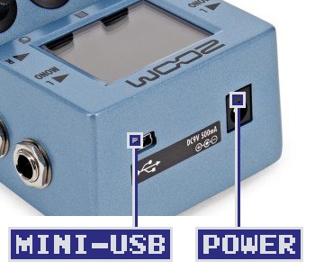

6. Run `MIDISTOMP V2.0 Updater.exe` and let it finish. Don't unplug during the update.
7. Unplug and power on normally. The boot screen reads **MIDISTOMP MOD v2.0**, and MENU > SYSTEM shows **V2.0**.

   

8. **On an MS-70CDR,** set SETTINGS > **INPUT** to **STEREO** to get the stereo routing modes (see
   [SETTINGS](#settings)). On the MS-50G and MS-60B leave it on MONO.

Your patches and installed effects stay as they are. Patches saved before 2.0 load in Serial mode with every effect
in one line, so they sound exactly as before. The updater never rewrites the pedal's effects area or its
bootloader, so update mode is always there.

### On a Mac

> A much easier Mac install is on the way. The steps below work today, but they need Python and Terminal.

Zoom's Mac updater holds the same firmware files as the Windows one and runs the same flash steps, so a MIDISTOMP
version of it can be built too. The build has been checked byte for byte against the Windows MIDISTOMP updater and
flashed to an MS-50G from an Apple Silicon Mac.

1. Download Zoom's **MS-70CDR v2.10** updater **for Mac** from the
   [MS-70CDR support page](https://zoomcorp.com/en/us/multi-effects/multistomp-pedals/ms-70cdr/ms-70cdr-support/)
   (a file like `MS-70CDR_v2.10_Mac_E.zip`) and unzip it. Use this one for the MS-50G and MS-60B too.
2. Get this repository (`git clone`, or Code > Download ZIP on GitHub) and Python 3.10 or newer (from python.org or
   Homebrew; the `python3` that comes with macOS is too old). Then in the repository's folder:
   ```sh
   python3 -m venv .venv && .venv/bin/pip install -e .
   .venv/bin/python scripts/midistomp_builder.py "/path/to/ZOOM MS-70CDR v2.10 Updater.app"
   ```
   It writes **MIDISTOMP V2.0 Updater.app** next to Zoom's app, and refuses anything that is not Zoom's original.
3. Changing the app breaks Zoom's code signature, so sign it for your own Mac:
   ```sh
   xattr -cr "/path/to/MIDISTOMP V2.0 Updater.app"
   codesign --force --deep --sign - "/path/to/MIDISTOMP V2.0 Updater.app"
   ```
4. Put the pedal in update mode (step 5 above) and open the app. It is an Intel app, so Apple Silicon Macs run it
   through Rosetta (macOS offers to install it). Its window reads **MIDISTOMP V2.0 Updater**; click Execute.

After MIDISTOMP is installed, the pedal reports itself as an MS-70CDR over USB, whichever pedal it is. Zoom's MS-50G
Mac updater only accepts its own model, so it will refuse the pedal ("Illegal device connected"). On a Mac, recover
with Zoom's MS-70CDR Mac updater (it accepts an MS-50G running MIDISTOMP) or the MIDISTOMP one.

### Recovery and going back to stock

If the pedal doesn't boot, or you want the stock firmware back:

1. Enter update mode (hold up + down while plugging in USB). This works even when the firmware is broken.
2. Run Zoom's original updater for your pedal: the MS-70CDR 2.10 one, or the MS-50G or MS-60B one you had before.
   It puts back the stock firmware and the stock boot screen. On a Mac, use the MS-70CDR one (see above).

On an MS-60B you can also run Zoom's MS-60B updater to go back to the bass firmware (4 effects per patch).

<p align="right"><sub><a href="#contents">↑ Contents</a></sub></p>

## 3. Getting around

### The keys

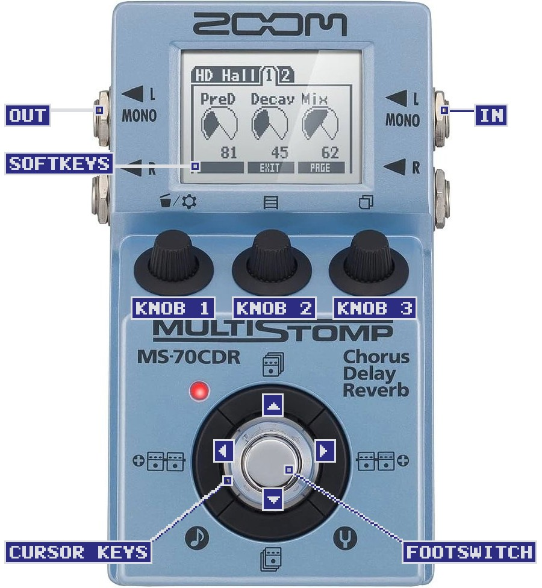

The four **cursor keys** sit around the footswitch. The three **knobs** are knob 1 (left), knob 2 (middle) and
knob 3 (right).

Most MIDISTOMP screens with pages (the Effect Chain's node and jack pages, MASTER and SYSTEM)
use the knobs the same way. The softkey above each knob names what its press does:

| Knob | Press |
|---|---|
| Knob 1 | the page's option (shown in the left softkey) |
| Knob 2 | **EXIT** |
| Knob 3 | next page (the right softkey names it) |

In lists (MENU, SETTINGS, MIDI, PERFORM MODE), turn knob 1 to scroll, press knob 1 (**ENTER**) to open a row, turn
knob 3 to change a row that has a value, and press knob 2 to go back.

The Effect Chain screen itself and KALEIDO have their own keys, explained in [Moving around](#moving-around) and
[KALEIDO](#kaleido).

### Button combos and scrolling

- In the effect chain or effect view, hold **down + right** about 1 s for the tuner, and **down + left** for the tempo
  screen. The pedal already marks them: the tuning fork sits under down + right, the note icon under down + left.
- In the tuner, press knob 2 (**EXIT**) to go back to the effects.
- Left and right move between the effects of a patch several times faster than stock. At the last effect, one more
  press slides back to the first one, and the other way round.

### The MENU

<p> 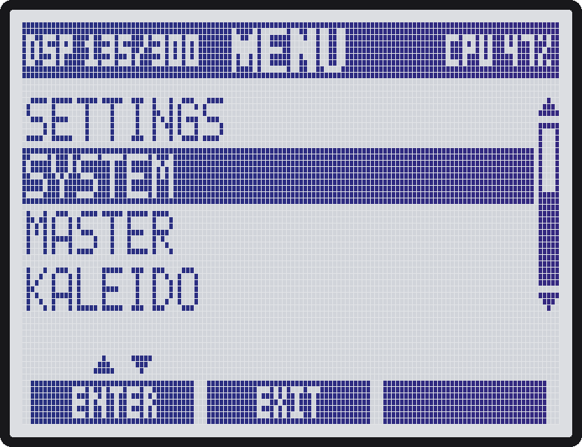</p>

Press knob 1 in the effect view to open the MENU:

**DELETE EFFECT UNIT, EFFECT CHAIN, PERFORM MODE, SETTINGS, SYSTEM, MASTER, KALEIDO.**

- The title bar shows the patch's DSP use on the left (`DSP 135/300`: what the effects declare, out of the new limit
  of 300; stock stops at 225) and the pedal's CPU load on the right (`CPU 47%`).
- MIDI is now the last row of SETTINGS.
- The old VERSION entry is now SYSTEM.
- EXIT from any entry goes back to the MENU with that entry selected.

<p align="right"><sub><a href="#contents">↑ Contents</a></sub></p>

## 4. EFFECT CHAIN ROUTING

<p> 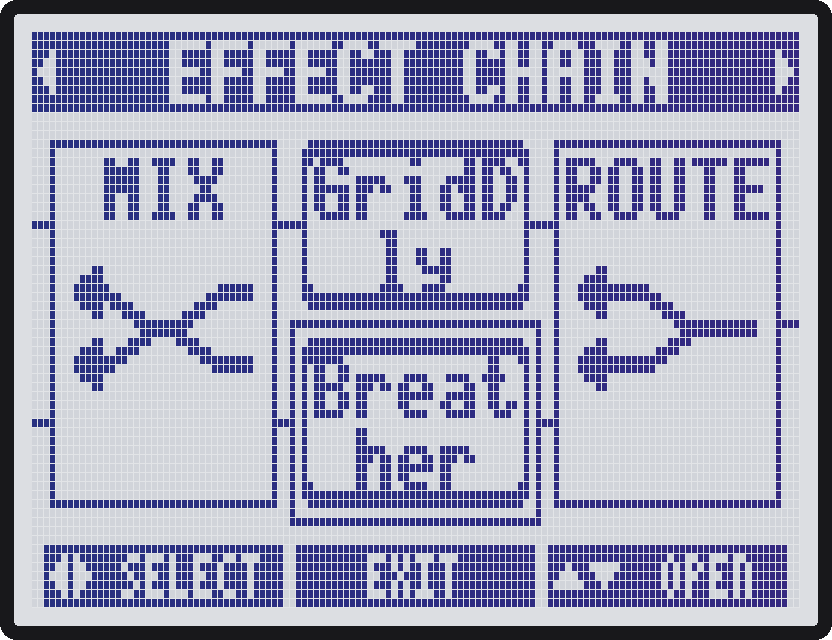</p>

MENU > **EFFECT CHAIN** is where you order the effects, as on the stock pedal. In 2.0 it is also where you set the
routing. The signal runs **right to left**, like the jacks on the pedal:

```
OUTPUT ← Post ← [MIX] ← Bus A / Bus B ← [ROUTE] ← Pre ← INPUT
```

- **Pre:** effects right of `[ROUTE]`, before the split.
- **Bus A / Bus B:** the two parallel buses, A on the top row, B on the bottom row.
- **Post:** effects left of `[MIX]`, after the merge.
- **`[ROUTE]`** splits the signal and **`[MIX]`** merges it. They are drawn like effects and have their own knob
  pages, but they **don't use effect slots**: you still get 6 effects.
- **IN** (right end) and **OUT** (left end) are the jacks, one plug per channel. They don't move, but you can open
  them for the Input and Master levels.

Any of the 6 effects can sit in Pre, Bus A, Bus B or Post. A dry path is just an empty bus, or a bus with its
effects off. The icon in `[ROUTE]` and `[MIX]` shows the current mode.

### Moving around

<p>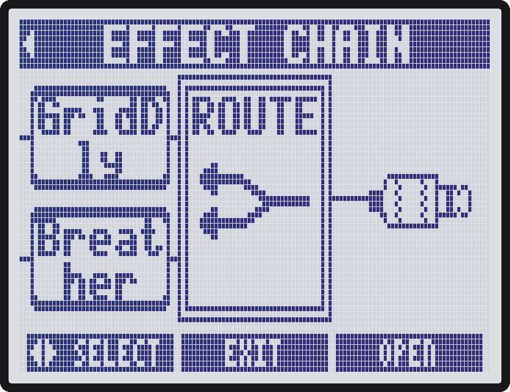 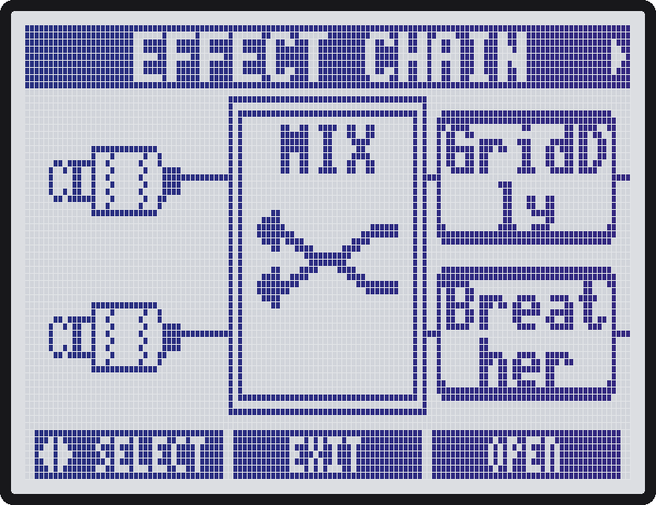</p>

| Control | Browsing | With an item selected |
|---|---|---|
| Knob 1 turn | move the cursor along the chain | move the item; past `[ROUTE]` or `[MIX]` it changes zone |
| Knob 1 press | **SELECT** | **DROP** |
| Knob 2 press | **EXIT** | nothing |
| Knob 2 hold (0.6 s) | | effects only: **DELETE?**, then press knob 2 again to delete; anything else cancels |
| Knob 3 turn | on a bus effect, jump to the other bus row | bus effect: move it to the other bus; `[ROUTE]`: Mode; `[MIX]`: Output Mode |
| Knob 3 press | **OPEN** the item's knob pages | **OPEN** (also drops the item) |
| Cursor ◄ / ► hold | add an effect on that side, in the same zone | |
| Cursor ▲ / ▼ | change the type of the effect under the cursor | |

- Moving `[ROUTE]` or `[MIX]` past an effect moves that effect between Pre/Post and the buses. `[ROUTE]` always
  stays right of `[MIX]`.
- Delete needs a long press and a confirmation, so pressing knob 2 twice to leave can never delete an effect.
- EXIT from the pages of a node or a jack goes back to the Effect Chain. EXIT from an opened effect works as stock.
- In the effect view, an effect's knob pages show where it sits as a tag in the tab row: **R** (Pre), **A** or
  **B** (a bus) or **M** (Post).

### Routing modes

`[ROUTE]` **Mode:**

| Mode | What it does | Needs |
|---|---|---|
| **Serial** | as stock: one line through every effect. `[MIX]` and the bus rows disappear | |
| **Parallel** | Pre, then the signal splits into Bus A and Bus B, which merge again at `[MIX]` | |
| **Split** | the L input goes to Bus A only, the R input to Bus B only | INPUT: STEREO |
| **Mono Serial** | as Serial, but L and R are summed to mono at `[ROUTE]` | INPUT: STEREO |

In the Serial modes the effects run in this order: Pre, Bus A, Bus B, Post. Each effect remembers its bus, so going
back to Parallel restores the layout.

`[MIX]` **Output Mode:**

| Output Mode | At the jacks |
|---|---|
| **Stereo** | A + B as a stereo pair, through the Post effects |
| **Mono** | the same, summed to mono at the very end |
| **Split** | Bus A on the L jack, Bus B on the R jack |

<p>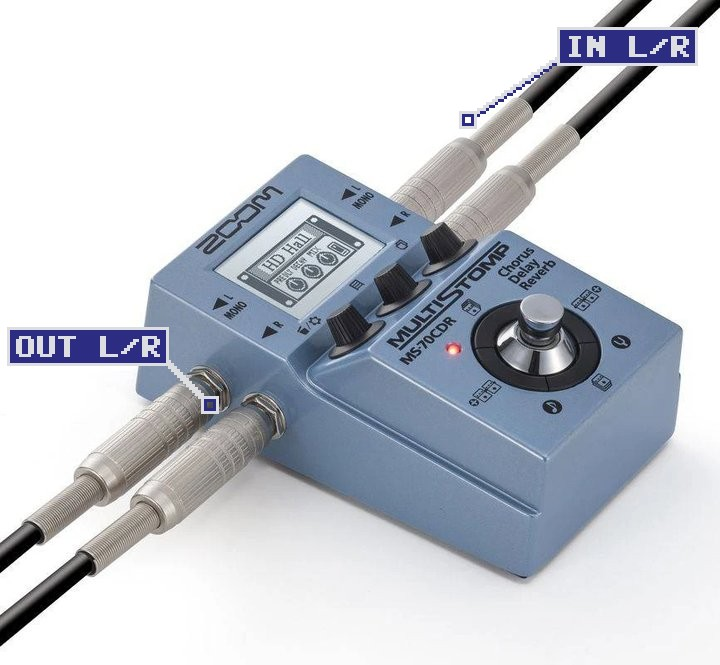</p>

Split and Mono Serial need a stereo input: two cables into the L and R inputs, and SETTINGS > INPUT set to STEREO.

With Split input or Split output, only effects that process L and R fully apart keep the two sides separate. Most
others mix one side into the other. That can be useful on purpose, so nothing stops it.

### Node knob pages

<p>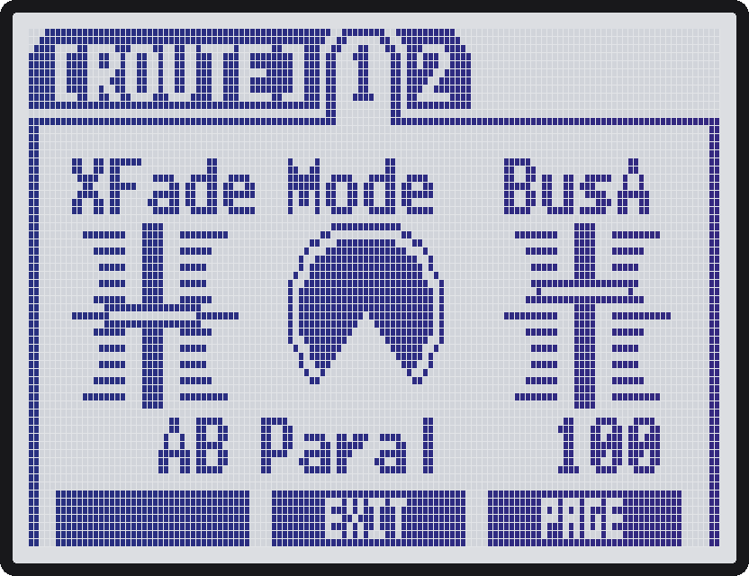 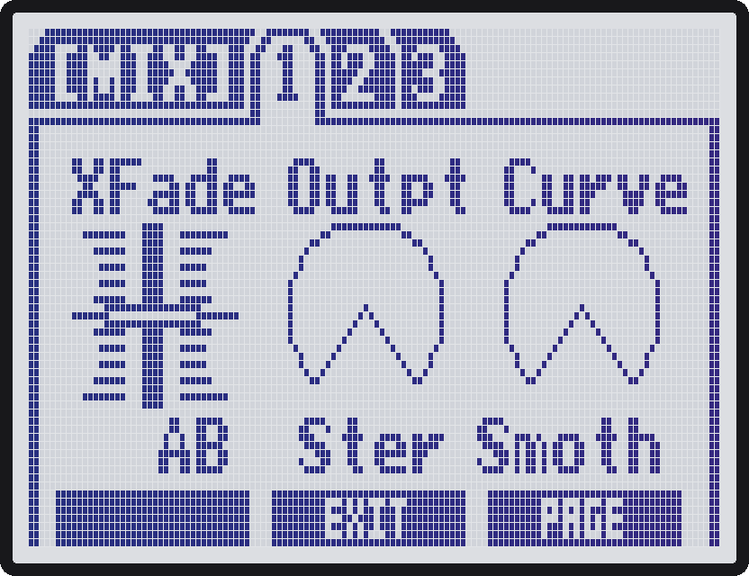 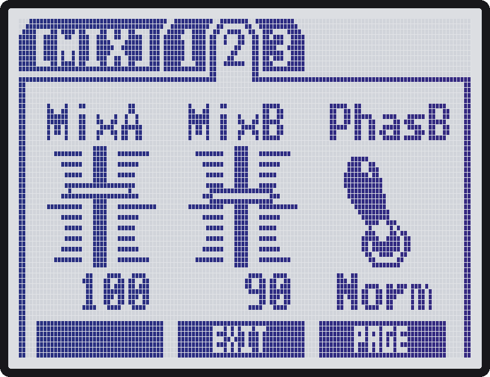</p>
<p>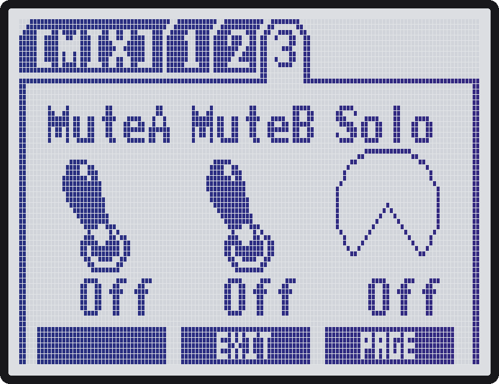 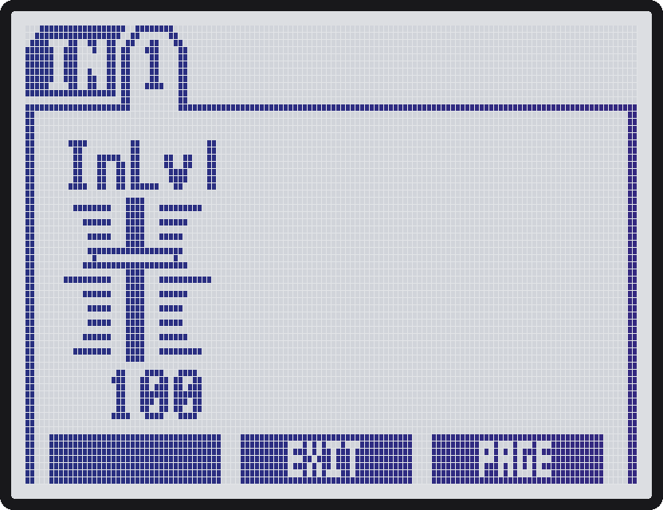 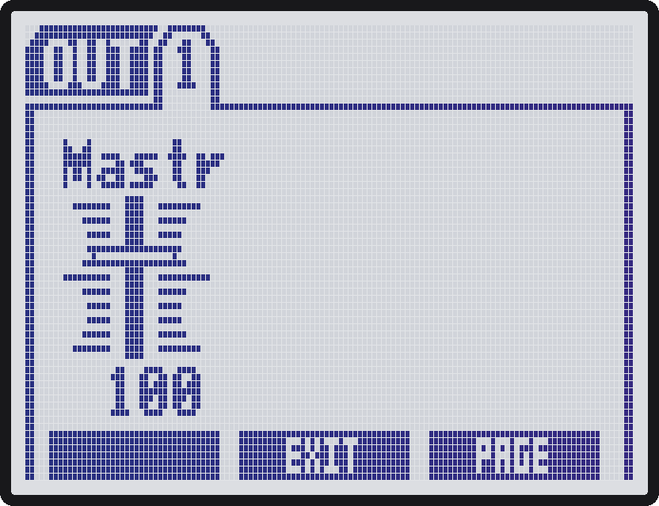</p>

Open a node or a jack with knob 3 press on the Effect Chain. The pages look like stock effect pages; knob 3 press
goes to the next page and knob 2 is EXIT. Page 1 is for playing, the other pages are for setup.

| Item | Page | Knob 1 | Knob 2 | Knob 3 |
|---|---|---|---|---|
| **IN** | 1 | Input Level (Split input: Input L) | Split input: Input R | |
| **`[ROUTE]`** | 1 | **XFade**: the send, A ↔ B (centre = both full) | Mode | Bus A level |
| | 2 | Bus B level | | |
| **`[MIX]`** | 1 | **XFade**: the crossfade, A ↔ B | Output Mode | Crossfade Curve |
| | 2 | Bus A level | Bus B level | Phase invert, Bus B |
| | 3 | Mute A | Mute B | Solo (Off / A / B) |
| **OUT** | 1 | Master Level (Split output: Master L) | Split output: Master R | |

- **Levels** go 0-150, with 100 = unity (150 is about +3.5 dB), so a quiet chain or bus can be boosted.
- **Crossfades** read like a pan: A100 … A50 … AB … B50 … B100.
- **Crossfade Curve:** **Smooth** keeps the level even across the sweep (slow fades). **DJ** keeps both buses at
  full level up to the middle, like a DJ mixer (transitions). **Cut** switches hard at the centre (stabs).
- **Mute / Solo:** Solo overrides Mute. Muted buses keep running, so the DSP load doesn't change.
- A control that does nothing in the current mode shows `—`.
- If the send and the crossfade point at opposite buses, the output is silent; a **!** badge on `[MIX]` warns you.

### Safety limiter

A limiter always sits at the very end, after Master. It catches a level boost so the output never clips. While it
works, a small **LIMIT** tag shows over the OUT plugs. For loudness on purpose, put a limiter or compressor effect
in Post.

### Saving

Routing, node settings and bus levels are saved with the patch, like any other edit: STORE, AUTO SAVE, and the save
prompt on a patch change. Clicks when you change routing live are normal, as when you change effects live.

<p align="right"><sub><a href="#contents">↑ Contents</a></sub></p>

## 5. PERFORM MODE

<p> 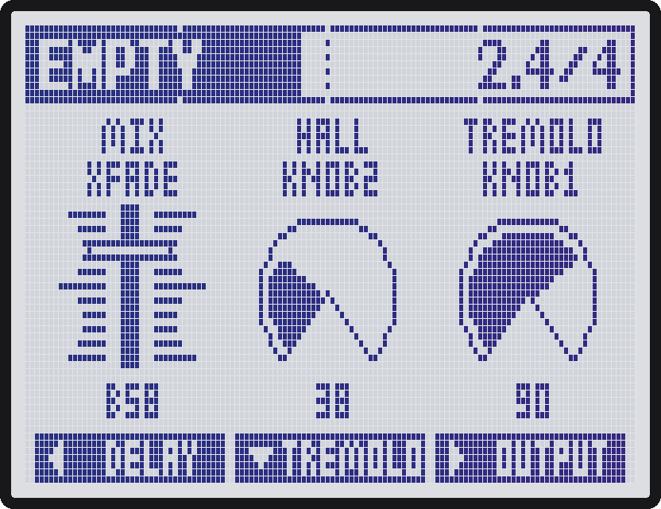</p>

Perform mode puts the controls you need while playing on one screen. **Every control has one target:** an effect
knob, an effect's on/off, a routing control or the looper's footswitch. Several controls may share a target; one
control never has two. Each gesture moves its target and can schedule a follow move later, on the grid.

### Getting in and out

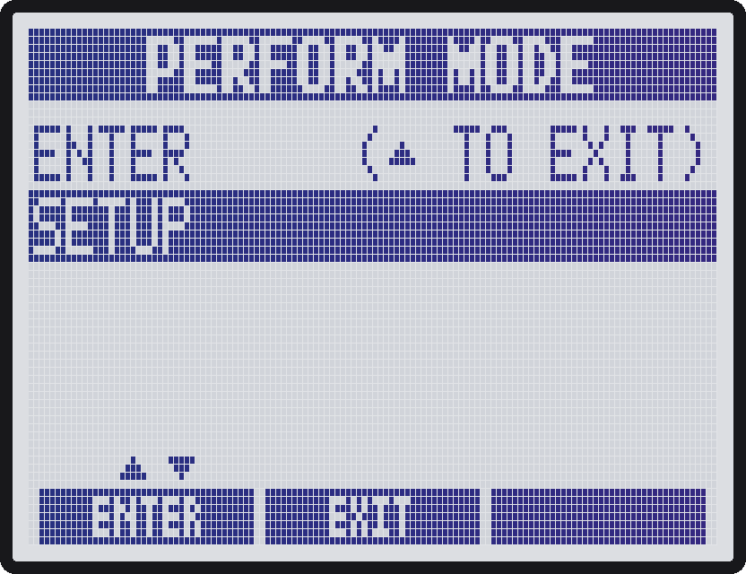

- MENU > **PERFORM MODE** > **ENTER** goes in. **SETUP** sets the controls (below).
- **Cursor ▲ always leaves.** It is the one key that can't be assigned.
- Inside, HOLD FOR and the button combos are off: every control belongs to Perform mode.
- Leaving keeps everything: moved values stay where they are, and waiting moves still happen.

### The screen

<p>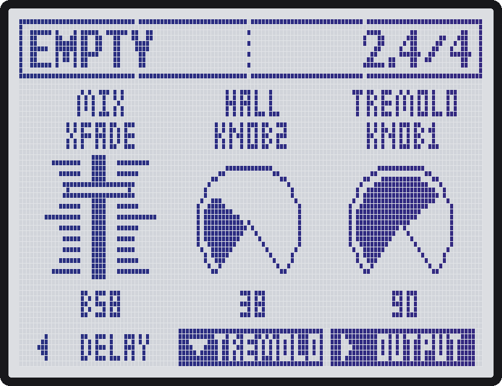 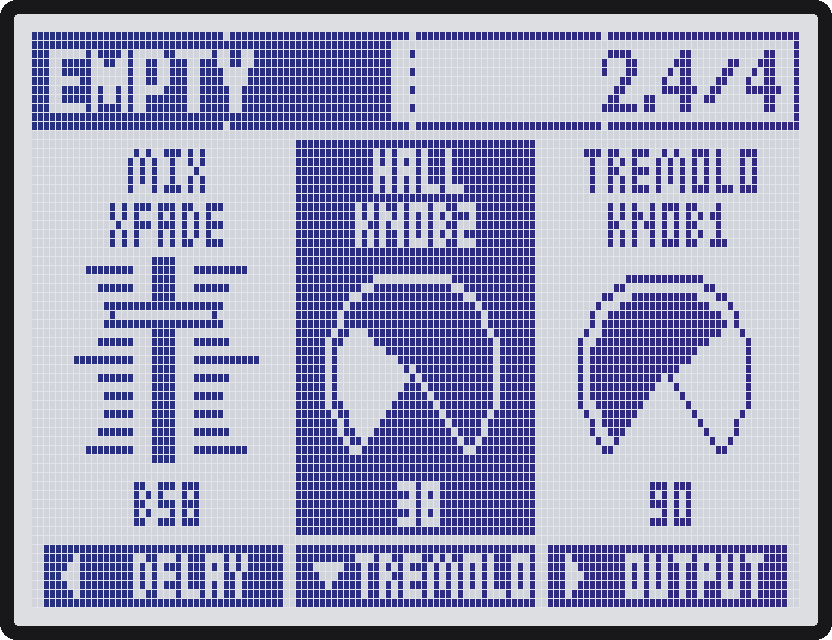 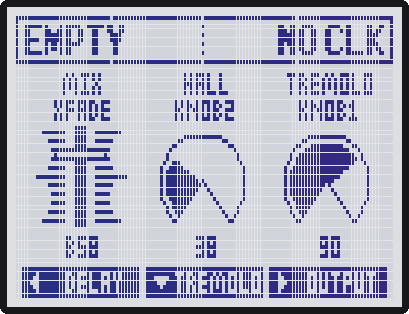</p>

- **Top bar:** the looper state on the left (EMPTY, REC, PLAY, STOPPED) and bar.beat / cycle on the right. Bar lines
  are marked across the bar. What is about to happen shows here too, for example `REC IN 3 BEATS`. `NO CLK` means
  no MIDI clock is running.
- **Knob columns:** like a stock knob page: the effect, the parameter, the control and the value. The column of the
  knob you touch lights up.
- **Softkeys:** the targets of cursor ◄, ▼ and ►. A softkey is inverted while its target is away from its default.
- **Blinking:** a waiting move's column and softkey blink, faster as the moment comes closer, locked to the grid.
  The footswitch LED blinks the same way.

### Gestures

| Control | Gestures |
|---|---|
| Knobs 1-3 | turn, press, hold |
| Cursor ◄ ▼ ► | press, hold |
| Footswitch | press, hold |
| Cursor ▲ | always leaves (not assignable) |

| Gesture | Moves |
|---|---|
| Turn | Follow (the turn itself sets the value) |
| Press | Action, Follow |
| Hold | Action, Release, Follow |

The knobs tell a turn, a press and a hold apart even if you click while turning or turn a little while pressing.

### Every move: Value, Next, Lag

| Setting | Choices |
|---|---|
| **Value** | `-` (unused), then the target's own range |
| **Next** | NOW · 1, 2, 4, 8 BEAT · 1, 2, 4, 8, 16, 32 BAR · 1, 2, 4, 8, 16, 32 CYC |
| **Lag** | OFF · MICRO · 50, 100, 500 MS · 1 S · 1, 2, 4, 8 BEAT · 1, 2, 4, 8, 16, 32 BAR |

- **Next** waits for the next line of that grid. Beats, bars and cycles count from bar 1: pressed in bar 6 with
  NEXT 8 BAR, the move lands on the bar-9 line.
- **CYC** is the patch's cycle, 1-32 bars, set in SETUP. The looper's loop length is the cycle length.
- A **Follow** lands exactly its Next **after** its Action or Release, so it stays on the grid. A Turn's Follow
  waits for the next line.
- **Lag** is how long the value takes to get there. MICRO is the shortest ramp that doesn't click.
- **The newest move wins:** a move that comes due while an earlier one is still gliding takes over from wherever
  the value is.
- **Stepped targets** (on/off, modes) take the step, as when the CC comes over MIDI.
- **No clock running:** moves with a Next fire at once.
- **MIDI Start or Stop, or a patch change,** cancel waiting moves and restart the grid. A tempo change just moves
  the grid with it.

### SETUP

<p>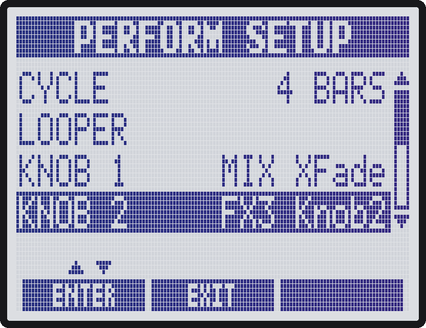 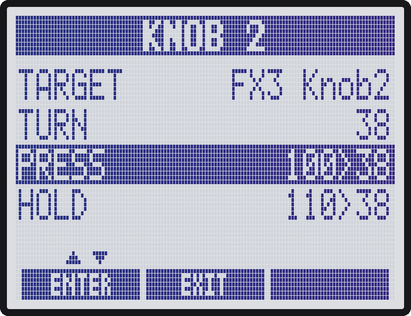 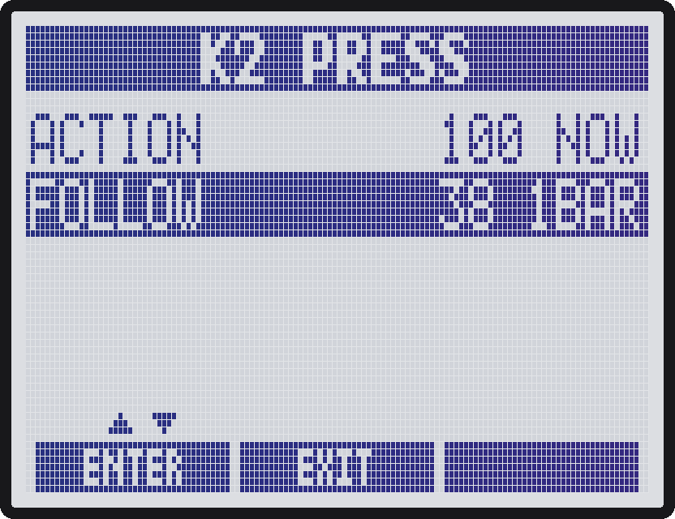</p>
<p>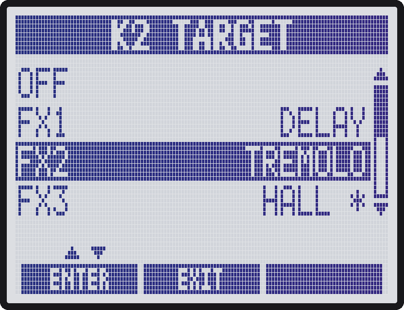 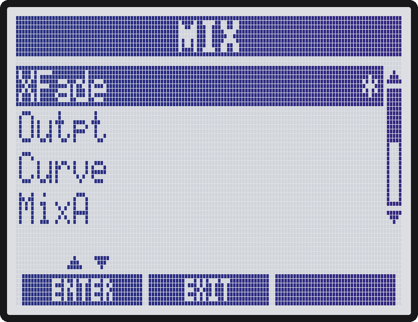 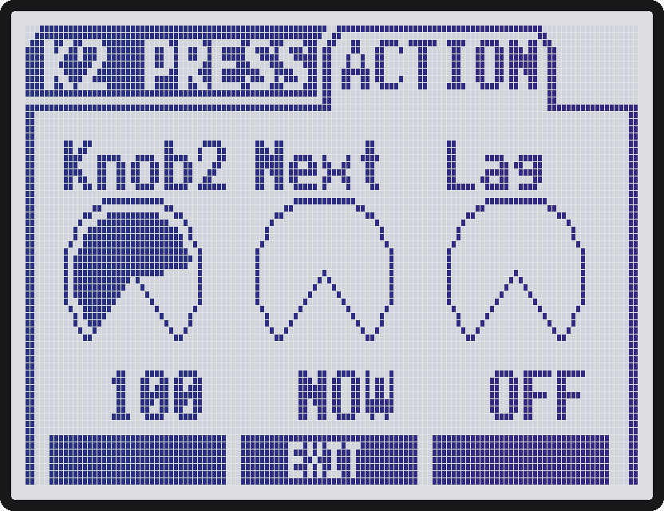</p>

MENU > PERFORM MODE > **SETUP**:

1. The list: **CYCLE** (bars), **LOOPER** (only when the patch has the looper), then one row per control with its
   target.
2. Open a control: **TARGET**, then one row per gesture with its values (`100>38`: the Action goes to 100, the
   Follow back to 38).
3. **TARGET** is picked in two steps: the module (an effect `FX1`-`FX6`, `ROUTE`, `MIX`, `IN`, `OUT`), then its
   parameter. `*` marks the current target. Every effect has **OnOff**; the looper also has **Ftsw** (its
   footswitch) and **Roll**.
4. Open a gesture to see its moves (ACTION, RELEASE, FOLLOW), and open a move: the three knobs set **Value**,
   **Next** and **Lag**.

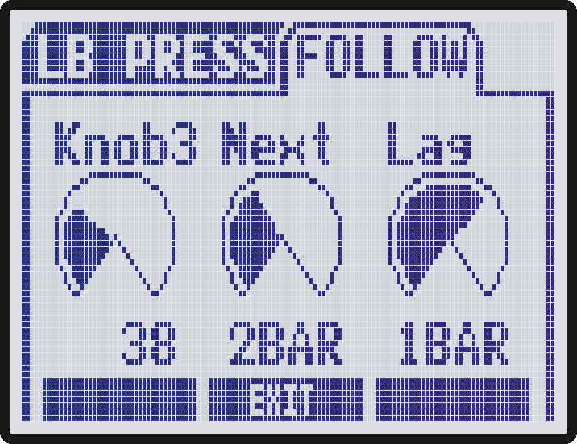

- Targets are **by position**: `FX1` is the first effect in the chain. Moving an effect moves its assignments to
  whatever takes its place.
- Every target is a MIDI CC inside (the [CC chart](#8-midi-and-the-cc-chart)), so the same things can be driven from a controller.
- Assignments are **saved per patch**.

### The LOOPER menu

In SETUP > **LOOPER** (when the patch has GRDLOOP):

- **SYNC** OWN / SLAVE, as on the [looper](#6-looper-grdloop).
- One row per loop event: **REC START, REC END, PLAY, STOP, DELETE, LOOP START** (every pass). Each has one target
  and one move (Value, Next, Lag), no Follow.

A new patch with the looper starts with: footswitch → looper Ftsw; REC END → MIX XFade to B100 over 1 BAR;
DELETE → MIX XFade to A100, MICRO.

### Example: a transition

A 4-bar cycle, MIDI clock from a drum machine, the live guitar on Bus A and GRDLOOP on Bus B:

1. Press the footswitch. Recording waits for the next cycle line, then records.
2. Press again: recording ends on the next cycle line and the crossfade glides to the loop. Change the drum
   pattern; the loop keeps playing.
3. Turn knob 1 (MIX XFade) to bring the live guitar back in. A knob on an effect's Mix with a Follow throws the
   effect and brings it back by itself at the end of the cycle.
4. Press the footswitch: the loop stops at the next cycle line. Double press deletes it, and the crossfade goes back
   to live.

<p align="right"><sub><a href="#contents">↑ Contents</a></sub></p>

## 6. LOOPER: GRDLOOP

GRDLOOP is a tempo-synced looper effect from the
[effects pack](https://github.com/matujuice/zoom-ms-zdl-effects-pack). Install it with [Effect Manager](#11-effects-and-effect-manager) and
put it in a patch like any effect: one per patch. On a bus in Parallel mode it becomes a loop bus next to the live
one. MIDISTOMP gives it a large memory, a footswitch that triggers instead of bypassing, and its state on screen and
on the LED.

| Page | Knob 1 | Knob 2 | Knob 3 |
|---|---|---|---|
| 1 | **Mix** 0-100 | **Roll** OFF, 1/2 … 1/32 | **Sync** OWN / SLAVE |
| 2 | **Next** NOW / BEAT / BAR / CYC | **Cycle** 1-32 bars | **Stop** KEEP / HALT |

- **Mix** crossfades live and loop, for Serial mode. In Parallel mode keep it at 100 and use the crossfade on `[MIX]`.
- **Roll** is latched: any setting but OFF rolls until the knob goes back to OFF. The roll starts on the next bar
  line and repeats the first slice of that bar. Turning it further while rolling makes the repeats shorter, each
  change on the grid.
- **Next** sets when a press lands: at once, or on the next beat, bar or cycle line.
- **Cycle** is the loop length in bars. With a CYCLE set in Perform mode, that one wins.
- **Sync:** **OWN** records until the line after your second press, so a loop is always whole cycles. **SLAVE**
  records one cycle, then plays by itself.
- **Stop:** what MIDI Stop and losing the clock do. **KEEP** (default): the loop keeps playing at the last tempo,
  and the next MIDI Start restarts it from bar 1. **HALT:** Stop halts the loop and Start plays it from bar 1.
- **Without a clock** the grid runs at the pedal tempo (tap or patch tempo).

### The footswitch

<p>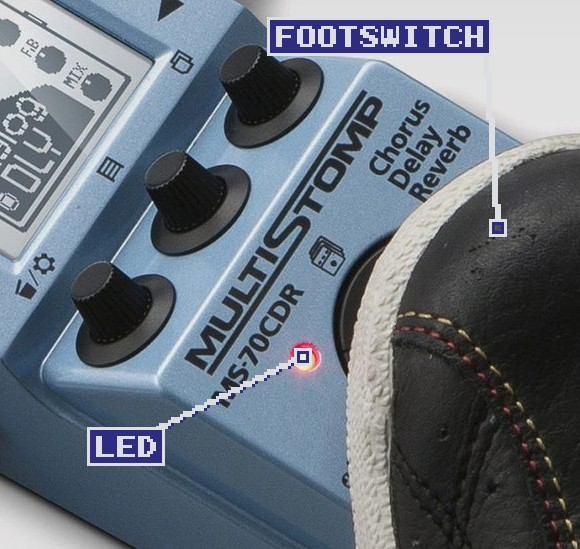</p>

With the looper on screen (or a Perform control aimed at its Ftsw), the footswitch drives the looper. Every action
waits for its Next line, except with NOW.

| State | Press | Double press |
|---|---|---|
| Empty | wait, record by Sync, then play | — |
| Playing | stop at the next line (the loop is kept) | delete the loop |
| Stopped | play again at the next line | delete the loop |

| Looper state | Footswitch LED |
|---|---|
| Empty | off |
| Waiting to record, stop or play | blinks, faster as the moment comes |
| Recording | slow pulse |
| Playing | on |
| Stopped | off |

- A press only records when the loop is empty. To record a new loop, delete the old one first.
- Stop is the looper's own stop, not a bypass. A bypassed 100 % wet effect on a bus would suddenly double the live
  sound.
- With the crossfade on the loop bus, stopping means silence: bring the crossfade back first, or let a Perform
  move do it.
- Before the first recording and while recording, only the dry part of Mix is heard.
- **MIDI:** the looper's on/off CC (14, 24 … 64 by position, [CC chart](#cc-chart-effects)) is its footswitch: a value of 64 or more is
  a press, two quick presses delete. This works from any screen.

### Memory

Loops are stored in 12-bit, about 72 dB under the signal. The looper picks stereo or mono when recording starts,
from the tempo and the cycle length:

| Length | Stereo | Mono |
|---|---|---|
| 1-2 bars | any tempo | |
| 4 bars | 48 BPM and up | 40-47 BPM |
| 8 bars | 96 BPM and up | 49-95 BPM |

If the cycle doesn't fit, the looper records what fits, halving the length, and the status says so (for example
`REC 4/8`). A mono loop stores L + R. Loops are lost on a patch change.

<p align="right"><sub><a href="#contents">↑ Contents</a></sub></p>

## 7. MASTER and KALEIDO

MENU > **MASTER** shows what comes out of the pedal: the signal after the whole chain, as you hear it. Knob 3 press
(or turn) steps through 6 pages, knob 1 sets the page's option, knob 2 is EXIT. MASTER opens again on the last page
you used, and costs nothing while it is closed.

<p> 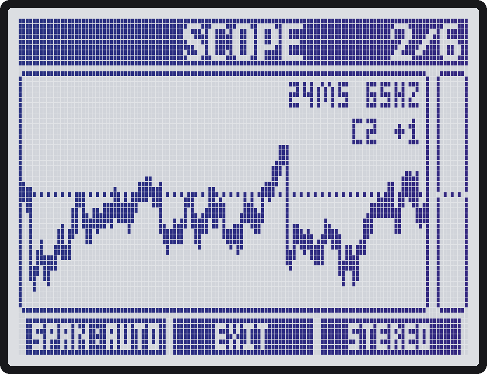 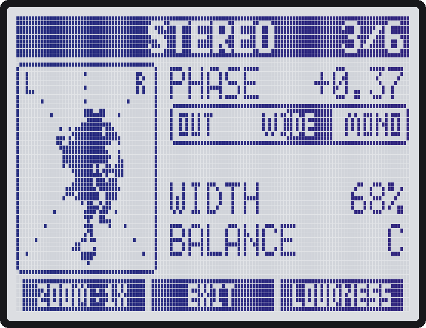</p>
<p>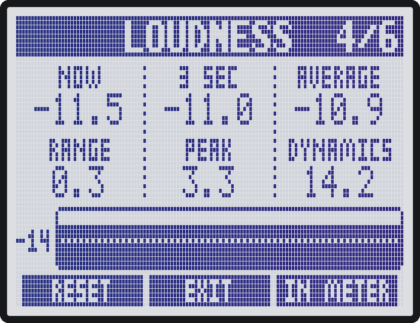 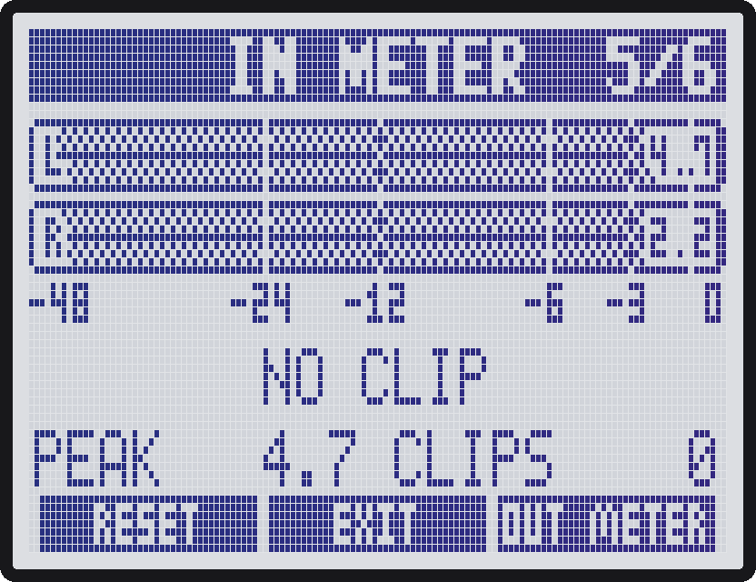 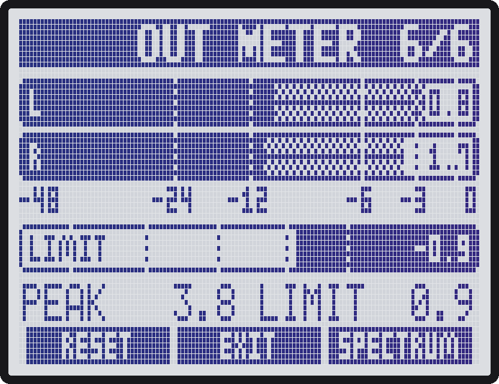</p>

| Page | Shows | Knob 1 |
|---|---|---|
| 1 **SPECTRUM** | the spectrum from 20 Hz to 20 kHz, with falling peaks | **FALL** SLOW / MED / FAST |
| 2 **SCOPE** | the waveform, held still on the note you play, with a **tuner** (frequency, note and cents) | **SPAN** AUTO or 1-24 periods |
| 3 **STEREO** | a goniometer, PHASE (correlation), WIDTH and BALANCE | **ZOOM** 1X / 2X / 4X |
| 4 **LOUDNESS** | LUFS: NOW (momentary), 3 SEC (short term), AVERAGE (integrated), RANGE (LRA), PEAK and DYNAMICS | **RESET** |
| 5 **IN METER** | the input level, L and R, with peak hold and clip count | **RESET** |
| 6 **OUT METER** | the output level, L and R, and the safety limiter's gain reduction (LIMIT) | **RESET** |

A patch change resets LOUDNESS.

### KALEIDO


MENU > **KALEIDO** fills the screen with a mirrored pattern that moves with the music. Bass zooms it and kicks fire
rings, mids warp it and switch the number of mirrors, highs speed it up and add sparkle, the level sets the contrast
and the L/R balance turns it. With MIDI clock running it flashes on every beat. It does nothing useful and that's
the point.

| Knob | Turn |
|---|---|
| Knob 1 | zoom |
| Knob 2 | spin |
| Knob 3 | mirrors: AUTO or a fixed number |
| Knob 2 press | EXIT |

<p align="right"><sub><a href="#contents">↑ Contents</a></sub></p>

## 8. MIDI and the CC chart

All MIDI goes over the USB cable: from a computer, an iPad or iPhone, or a USB-MIDI host box for hardware like a
drum machine.

### MIDI menu

<p> 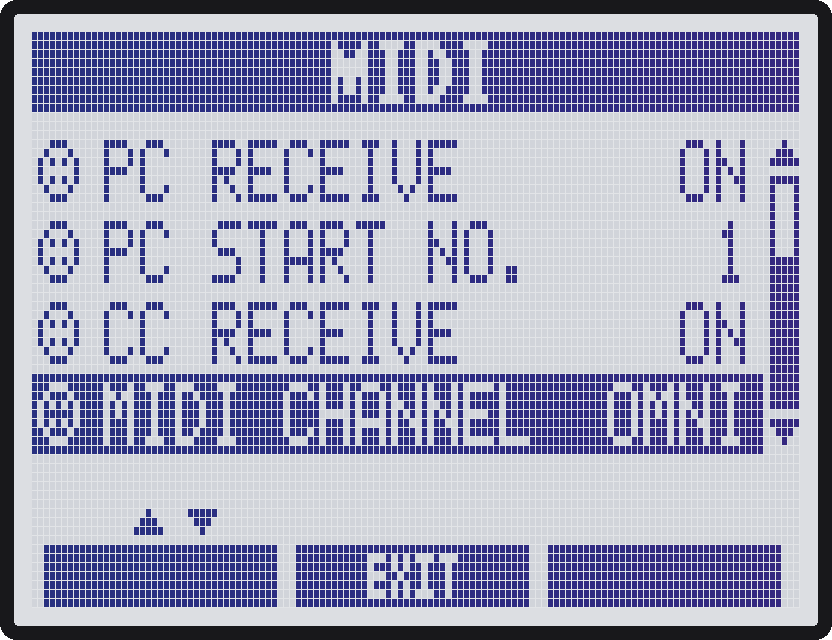</p>

SETTINGS > **MIDI** (the last row):

| Row | Choices | Default |
|---|---|---|
| CLOCK RECEIVE | ON / OFF | ON |
| TRANSPORT (Start/Stop) | ON / OFF | ON |
| PC RECEIVE | ON / OFF | ON |
| PC START NO. | 0 / 1 | 1 |
| CC RECEIVE | ON / OFF | ON |
| MIDI CHANNEL | OMNI, 1-16 | OMNI |

Settings are kept after power-off. Clock, Start and Stop have no channel, so MIDI CHANNEL never filters them.

**Program Change** loads a patch: with START NO. 1, PC 1 = patch 1 … PC 50 = patch 50. With START NO. 0, PC 0 =
patch 1.

**Control Change** turns effects on and off and moves knobs and routing controls (chart below). The screen follows.

**MIDI clock** sets the patch tempo, like tap tempo does, so tempo-synced effects follow your DAW or drum machine
(40-250 BPM). The tempo locks after about 2 beats and follows changes. Perform mode and the looper use the same grid.
Some stock effects (for example Delay) restart their echoes on every tempo change, as they do with tap tempo.

**Start / Stop** restart and stop the beat count, so the looper, Perform mode and the effects pack's effects stay on
the beat and restart on the downbeat.

### CC chart: effects

Any channel unless MIDI CHANNEL is set. Effect n is the n-th effect of the patch.

| | Effect 1 | Effect 2 | Effect 3 | Effect 4 | Effect 5 | Effect 6 |
|---|---|---|---|---|---|---|
| On/off (0-63 off, 64-127 on) | 14 | 24 | 34 | 44 | 54 | 64 |
| Knob 1 | 15 | 25 | 35 | 45 | 55 | 65 |
| Knob 2 | 16 | 26 | 36 | 46 | 56 | 66 |
| Knob 3 | 17 | 27 | 37 | 47 | 57 | 67 |
| Knob 4 | 18 | 28 | 38 | 48 | 58 | 68 |
| Knob 5 | 19 | 29 | 39 | 49 | 59 | 69 |
| Knob 6 | 20 | 30 | 40 | 50 | 60 | 70 |
| Knob 7 | 21 | 31 | 41 | 51 | 61 | 71 |
| Knob 8 | 22 | 32 | 42 | 52 | 62 | 72 |
| Knob 9 | 23 | 33 | 43 | 53 | 63 | 73 |

Values 0-127 cover the knob's whole range. A knob the effect doesn't have does nothing. On the looper, the on/off CC
is its footswitch ([LOOPER](#the-footswitch)).

### CC chart: effect chain routing

| CC | Control | CC | Control |
|---|---|---|---|
| 85 | `[ROUTE]` XFade (send) | 94 | Crossfade Curve |
| 86 | `[MIX]` XFade (crossfade) | 95 | Phase invert, Bus B |
| 87 | Master Level | 96 | Input R |
| 88 | Input Level | 97 | Master R |
| 89 | `[ROUTE]` Bus A level | 98 | Output Mode |
| 90 | `[ROUTE]` Bus B level | 99 | Mute A |
| 91 | `[MIX]` Bus A level | 100 | Mute B |
| 92 | `[MIX]` Bus B level | 101 | Solo |
| 93 | Mode | | |

- 0-127 covers the control's range. For levels (0-150) unity is CC value 84.
- 88 also sets Input R, and 87 also sets Master R, unless the input or output is Split, as the knobs do.
- CC 86 is the way to crossfade from the effect view, where the nodes don't show.

### Patch up/down

CC 80 with a value of 64-127 loads the previous patch, CC 81 the next one, wrapping between patch 50 and patch 1.
Values 0-63 do nothing, so a button that sends 127 when pressed and 0 when released steps once.

All CCs follow CC RECEIVE and MIDI CHANNEL. Patch up/down doesn't follow the PC settings.

<p align="right"><sub><a href="#contents">↑ Contents</a></sub></p>

## 9. SETTINGS and Tempo Lock

### SETTINGS

<p>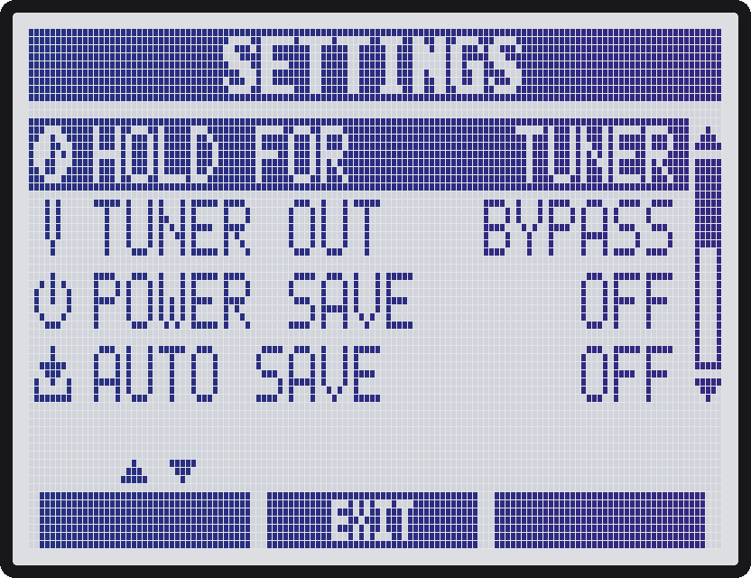  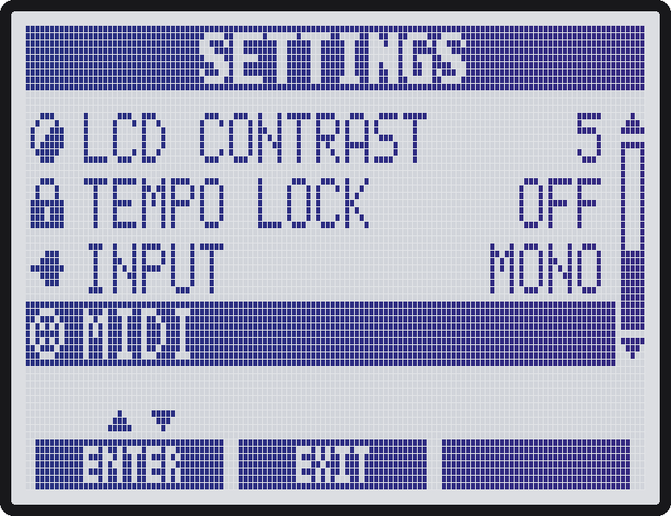</p>

MENU > **SETTINGS** holds the stock rows plus these:

| Row | Choices | What it does |
|---|---|---|
| **HOLD FOR** | TUNER / TEMPO / MOMENTARY | what holding the footswitch does (below) |
| **TEMPO LOCK** | OFF / ON | ON: changing patch keeps the current tempo ([Tempo Lock](#tempo-lock)) |
| **INPUT** | MONO / STEREO | which input the pedal has (below) |
| **MIDI** | opens the MIDI menu | [MIDI menu](#midi-menu) |

**HOLD FOR:**
- TUNER (default): opens the tuner, as stock.
- TEMPO: opens the tempo screen.
- MOMENTARY: a short press flips the effect as usual. Hold it over half a second and it flips back when you let go.
  The flip-back is never saved.

**INPUT:** the firmware can't tell the pedals apart, so tell it. **STEREO** on an MS-70CDR gives the Split and Mono
Serial modes. **MONO** (default) is for the MS-50G and MS-60B: those modes are not offered, and a patch that uses
them plays Split as Parallel and Mono Serial as Serial.

### Tempo Lock

<p> </p>

Press the knob labelled **TEMPO**: the screen shows the BPM and **TURN OR TAP**. Turn the knob for 1 BPM steps, or
tap the footswitch. It closes 2 s after the last turn or tap. While MIDI clock arrives it reads **MIDI CLOCK** and
can't be changed by hand.

**TEMPO LOCK** (SETTINGS) keeps that tempo when you change patch, so a whole set runs at one tempo. Tap, the tempo
screen and MIDI clock still change it. Off (default), each patch loads its own tempo, as stock.

<p align="right"><sub><a href="#contents">↑ Contents</a></sub></p>

## 10. SYSTEM

<p>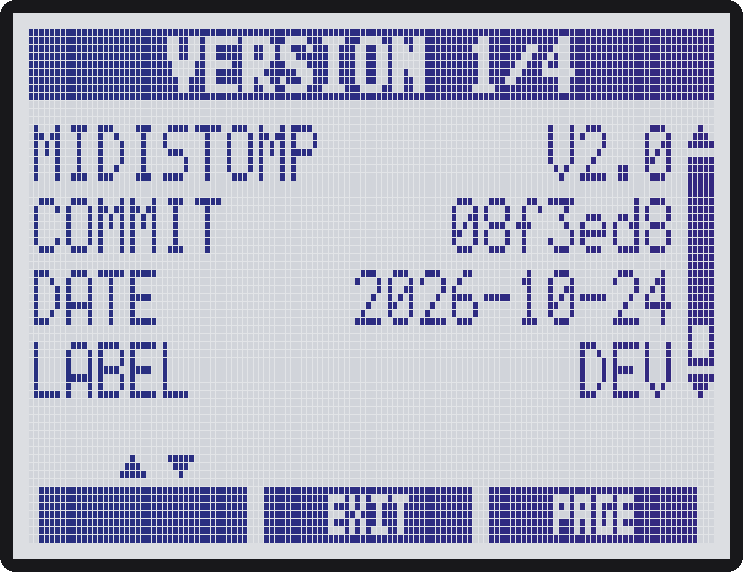 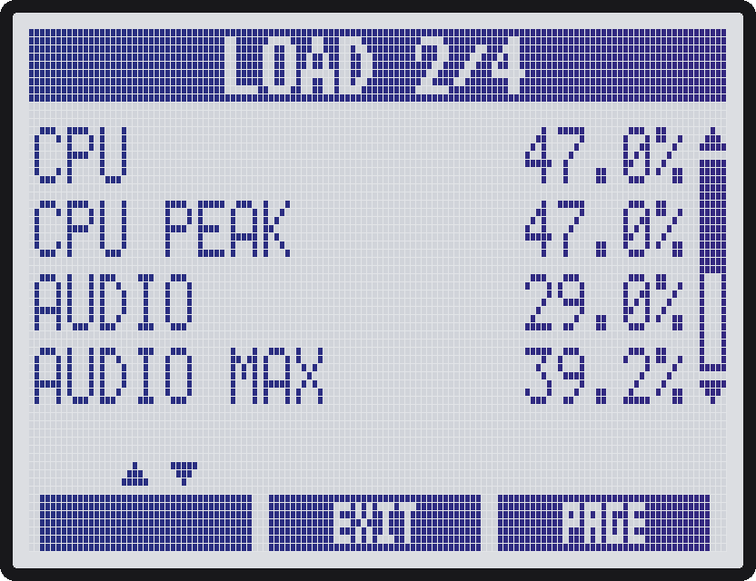</p>
<p>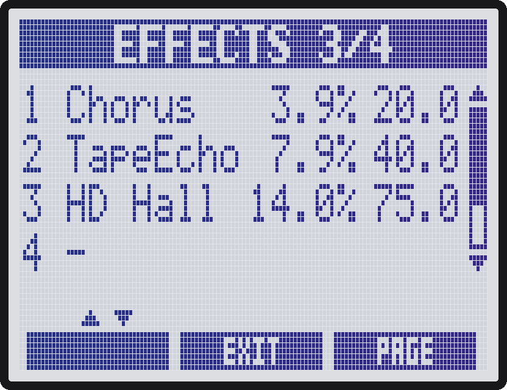 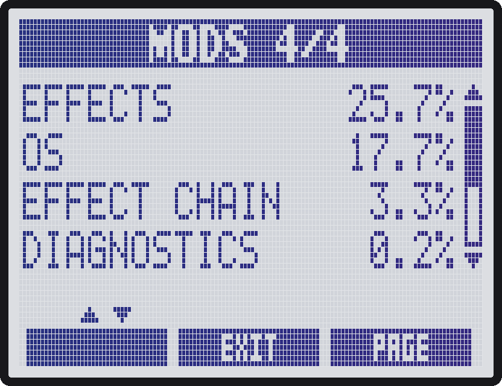</p>

MENU > **SYSTEM** has 4 pages. Knob 1 scrolls, knob 3 press goes to the next page, knob 2 is EXIT.

| Page | Shows |
|---|---|
| 1 **VERSION** | MIDISTOMP version, commit, date and label of the build |
| 2 **LOAD** | CPU (all of it), CPU PEAK since the page opened, AUDIO (the effect chain) and AUDIO MAX, the free headroom, late audio blocks, and the patch's declared DSP out of 300 |
| 3 **EFFECTS** | per effect: name, CPU share and declared DSP |
| 4 **MODS** | the CPU share of each part, from most to least: EFFECTS, OS, EFFECT CHAIN, PERFORM MODE, LOOPER BUFFER, MASTER, KALEIDO, MIDI and DIAGNOSTICS itself |

LOAD and MODS help you find what makes a heavy patch heavy. A late block means the CPU was full for a moment; a
patch change makes one or two, which is normal. MASTER and KALEIDO cost nothing while closed.

<p align="right"><sub><a href="#contents">↑ Contents</a></sub></p>

## 11. Effects and Effect Manager

Stock effects work with MIDISTOMP: MIDI clock sets their tempo and CC moves their knobs. But they were made long
before this firmware: they ignore Start/Stop, some delays cut out on tempo changes, and nothing locks to the bar.

The free effects in [zoom-ms-zdl-effects-pack](https://github.com/matujuice/zoom-ms-zdl-effects-pack) are built
around MIDISTOMP. They follow the pedal's tempo, lock to the clock's grid, restart on the downbeat with MIDI Start
and keep going after Stop. The looper, GRDLOOP ([LOOPER](#6-looper-grdloop)), comes from the pack too, and new effects keep coming.

See [what each knob does](https://github.com/matujuice/zoom-ms-zdl-effects-pack/blob/main/docs/EFFECTS.md).

**Effect Manager.** Zoom's Effect Manager and Zoom Effect Manager 2 work in **normal mode** (adding, removing and
ordering effects); MIDISTOMP stays installed. **Never use an Effect Manager's firmware update mode** on a MIDISTOMP
pedal: it can rewrite the firmware and remove MIDISTOMP.

**DSP.** MIDISTOMP raises the DSP limit from 225 to 300, so heavier patches fit. Parallel routing doesn't lower the
load, and stereo effects cost about twice as much as mono ones. The MENU shows the patch's DSP out of 300 and the
CPU %, and SYSTEM shows more. Near the top the CPU may run out before the DSP count does: if you hear clicks, drop
an effect. If a patch asks for more than 300, the stock **DSP FULL** message shows and the effect is bypassed.

<p align="right"><sub><a href="#contents">↑ Contents</a></sub></p>

## 12. Known limits and FAQ

- **MIDI only over USB.** The pedal has no MIDI DIN jacks; hardware needs a USB-MIDI host box.
- **Clock through an app.** Apps that regenerate the clock (for example Loopy Pro) can add lag; pass the clock
  through unchanged if you can.
- **Some delays cut out on tempo changes.** That is the effect itself (see [MIDI clock](#8-midi-and-the-cc-chart)).
- **Perform targets are by position.** Moving an effect in the chain moves its assignments to whatever takes its
  place.
- **Loops are lost on a patch change.** A transition happens inside one patch.
- **Going back to an older MIDISTOMP or stock** may start the pedal on patch 1 once. Patches made in 2.0 lose their
  routing on older firmware and play their effects in one line.
- *Is my pedal at risk?* The bootloader is never rewritten, so update mode is always there to recover, as in
  [Recovery](#recovery-and-going-back-to-stock).
- *Why do I need Zoom's updater?* Zoom's firmware can't be shared here; the builder only changes your own copy.
- *Found a bug or something unclear in this guide?* Please
  [open an issue](https://github.com/matujuice/zoom-ms-midistomp/issues), see [Feedback](#13-feedback-and-bug-reports).

<p align="right"><sub><a href="#contents">↑ Contents</a></sub></p>

## 13. Feedback and bug reports

Please [open an issue](https://github.com/matujuice/zoom-ms-midistomp/issues) for anything that doesn't work, anything
confusing, or an idea. Say which pedal and MIDISTOMP version you have (MENU > SYSTEM shows it), what you did and what
happened. A phone photo of the screen helps. Reports from MS-50G and MS-60B owners are especially welcome.

MIDISTOMP is free and made by one person. If it's useful to you, you can buy me a coffee:
[PayPal](https://paypal.me/matujuice) · [Buy Me a Coffee](https://buymeacoffee.com/matujuice) ·
[GitHub Sponsors](https://github.com/sponsors/matujuice)

<p align="right"><sub><a href="#contents">↑ Contents</a></sub></p>
